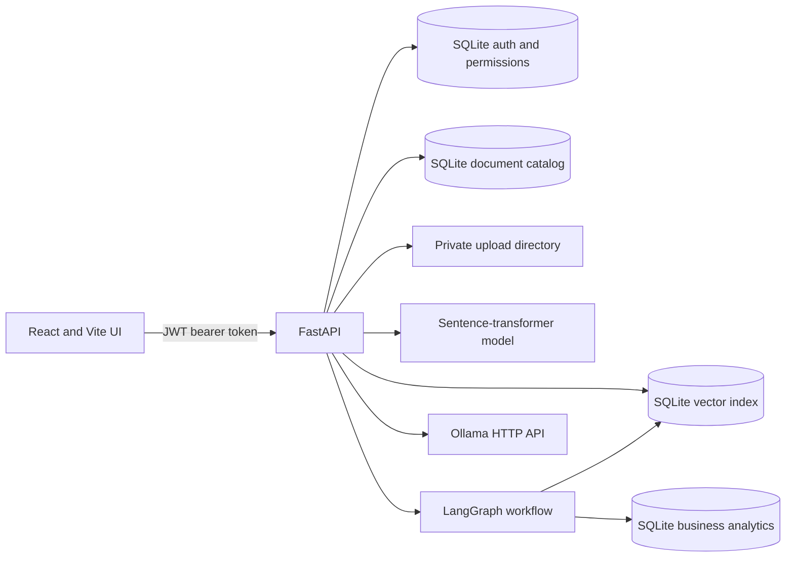

# Enterprise AI Research Agent

A local-first research application with a FastAPI API, a React dashboard, private document retrieval, a local Ollama model, and constrained business-data tools. The project supports repeatable local development and container builds; it is not yet a fully managed multi-tenant production service.

## Architecture



- Upload and extraction support PDF, DOCX, and CSV with a configurable size limit.
- Retrieval uses a persistent SQLite vector index and cosine similarity.
- RAG constructs model context only from document IDs the authenticated user may access and returns citations.
- The LangGraph agent chooses between document search and a small allowlist of parameterized SQL analytics tools.
- Authentication uses password hashing and signed JWTs; private ownership and share records are stored in SQLite.
- Document summaries are persisted separately from uploaded files and extracted text.
- Structured request logs include a correlation ID, method, path, status, and duration; credentials and document bodies are not logged by the request middleware.

## Prerequisites

- Python 3.13 (the version exercised in this workspace and CI).
- Node.js 22 and npm for the frontend.
- Ollama installed on the host for model-backed answers. The model is downloaded separately.
- Docker Desktop or Docker Engine only for the container workflow.

## Local setup

From the repository root in PowerShell:

```powershell
py -3.13 -m venv .venv
.\.venv\Scripts\python.exe -m pip install --upgrade pip
.\.venv\Scripts\python.exe -m pip install -r requirements.txt
Copy-Item .env.example .env
```

Generate a local JWT secret and replace the sample value without printing it to the console:

```powershell
$jwtSecret = .\.venv\Scripts\python.exe -c "import secrets; print(secrets.token_urlsafe(48))"
(Get-Content .env) -replace '^JWT_SECRET=.*', "JWT_SECRET=$jwtSecret" | Set-Content .env
Remove-Variable jwtSecret
```

Install and prepare Ollama on the host:

```powershell
ollama pull qwen2.5:0.5b
```

Start the backend in one terminal:

```powershell
.\.venv\Scripts\python.exe -m uvicorn backend.app.main:app --host 127.0.0.1 --port 8000
```

Start the frontend in another terminal:

```powershell
Set-Location frontend
npm ci
Copy-Item .env.example .env
npm run dev
```

Open `http://127.0.0.1:5173`. In development, account registration creates analyst accounts. Production disables public registration; provision an administrator using the interactive command below.

## Configuration

The backend loads the root `.env` file, then uses process environment variables as overrides. `.env.example` contains placeholders only. `.env` is ignored by Git.

| Variable | Purpose | Default |
| --- | --- | --- |
| `APP_ENV` | `development`, `test`, or `production` behavior | `development` |
| `JWT_SECRET` | JWT signing secret; production requires at least 32 generated characters | generated per process if unset outside production |
| `JWT_COOKIE_SECURE` | Secure flag for auth cookies; must be true in production | true in production, false otherwise |
| `ALLOW_SELF_SERVICE_REGISTRATION` | Public analyst/viewer registration; production requires false | true outside production |
| `ACCESS_TOKEN_TTL_MINUTES` | JWT lifetime (1 minute to 24 hours) | `60` |
| `CORS_ALLOWED_ORIGINS` | Comma-separated exact frontend origins; production requires HTTPS origins | local Vite origins |
| `LOG_LEVEL` | Python logging level | `INFO` |
| `DATA_DIR` | Base path for local application data | `data` |
| `AUTH_DB_PATH` | User and document permission database | `data/auth.sqlite3` |
| `DOCUMENT_CATALOG_PATH` | Persisted document summaries | `data/documents.sqlite3` |
| `UPLOAD_DIR` | Original uploaded files | `data/uploads` |
| `RAG_INDEX_PATH` | Vector index | `data/index/vector_index.sqlite3` |
| `BUSINESS_DB_PATH` | Synthetic analytics database | `data/business_analytics.sqlite3` |
| `HF_HOME` | Hugging Face model cache | `data/models/huggingface` |
| `OLLAMA_BASE_URL` | Ollama API address | `http://127.0.0.1:11434` |
| `OLLAMA_MODEL` | Ollama model tag | `qwen2.5:0.5b` |
| `OLLAMA_TIMEOUT_SECONDS` | Request timeout | `90` |
| `EMBEDDING_MODEL` | Sentence-transformer model identifier | `sentence-transformers/all-MiniLM-L6-v2` |
| `MAX_UPLOAD_SIZE_BYTES` | Maximum accepted upload size | `10485760` |
| `RAG_MIN_RELEVANCE_SCORE` | Minimum retrieval similarity | `0.30` |
| `VITE_API_BASE_URL` | API URL compiled into the frontend bundle | `http://127.0.0.1:8000` |

For production, set `APP_ENV=production`, generate a new secret with a trusted secret manager (or the Python `secrets.token_urlsafe(48)` API) and inject it through the deployment secret store, set `JWT_COOKIE_SECURE=true`, set `ALLOW_SELF_SERVICE_REGISTRATION=false`, and configure only the public HTTPS frontend origins. Do not place the generated value in logs, shell history, images, or source control.

To provision the first administrator after production configuration is available, run this on the backend host; it prompts for the password without putting it in shell history:

```powershell
.\.venv\Scripts\python.exe -m backend.app.provision_admin admin@example.com
```

## Storage and models

`data/` contains the auth database, document catalog, vector index, business analytics database, uploads, and embedding cache. These are local persistent state and are excluded from Git. Back up the databases and uploads together, and restrict filesystem access to the service account. Deleting the vector index loses searchability until documents are re-indexed. Ollama weights are managed by Ollama separately from this project; pull the configured model before expecting model-backed answers.

## Health checks

- `GET /api/v1/health` is liveness only: it confirms the API process responds and does not claim its dependencies are ready.
- `GET /api/v1/ready` actively checks Ollama/model availability, embedding load state, SQLite stores, and upload storage. It returns `503` with per-dependency states until all required dependencies are ready. A cold embedding model is reported as `not_loaded`, not healthy.
- `GET /api/v1/rag/status` reports RAG model/index details for the dashboard.
- Each API response includes `X-Request-ID`; a valid caller-provided ID is preserved, otherwise one is generated.

## Docker

Docker is optional for local development. The containers do not include uploaded content, databases, or model weights. Compose mounts a named volume at `/app/data`; Ollama runs separately on the host.

On Windows, install Docker Desktop and verify the Engine and Compose plugin:

```powershell
winget install --id Docker.DockerDesktop --exact
docker --version
docker compose version
docker info
```

Complete any Docker Desktop/WSL2 setup prompts and wait for the engine to start before continuing. On Linux, install Docker Engine and the Docker Compose plugin using the instructions for the target distribution, then run `docker --version`, `docker compose version`, and `docker info`.

1. Start Ollama on the host and make sure its configured model is pulled.
2. Create the root `.env` using the local setup instructions and set a real `JWT_SECRET`. For production, also set `APP_ENV=production`, `JWT_COOKIE_SECURE=true`, `ALLOW_SELF_SERVICE_REGISTRATION=false`, HTTPS CORS origins, and the browser-visible `VITE_API_BASE_URL` before building.
3. Start the local container stack:

```powershell
docker compose config
docker compose build
docker compose up -d
docker compose ps
docker compose logs --tail 100 backend frontend
```

The API is bound to `127.0.0.1:8000` and the frontend to `127.0.0.1:5173`. The backend container connects to host Ollama at `host.docker.internal:11434` by default. Confirm Ollama and the selected model are available from that host address; the API container health check only tests API liveness. The frontend image uses an unprivileged Nginx runtime. Stop the stack with `docker compose down`; the named data volume remains. `docker compose down -v` deletes that volume and its stored application data.

For public production traffic, terminate TLS at a maintained reverse proxy or cloud ingress, expose only HTTPS, and set CORS to the exact public frontend origin. TLS termination, certificate management, and cloud deployment resources are not included here.

Docker is not available in the current development environment, so the image build and Compose runtime have not been executed here. Run the commands above on a Docker-enabled machine before relying on the container setup.

## Tests and lint

Backend:

```powershell
.\.venv\Scripts\python.exe -m pytest -q
.\.venv\Scripts\python.exe check_security_isolation.py
```

Frontend:

```powershell
Set-Location frontend
npm ci
npm test
npm run lint
npm run build
```

GitHub Actions runs backend tests on Python 3.13 and frontend tests, Oxlint, and production build on Node 22. CI does not start Ollama, need paid credentials, or upload project documents. Backend tests use local fakes and temporary SQLite paths where possible.

## API routes

- `GET /` project metadata
- `GET /api/v1/health` liveness
- `GET /api/v1/ready` dependency readiness
- `POST /api/v1/auth/register`, `POST /api/v1/auth/login`, `GET /api/v1/auth/me`, `POST /api/v1/auth/logout`
- `POST /api/v1/documents/upload`, `GET /api/v1/documents`
- `POST /api/v1/chat/ask`, `GET /api/v1/rag/status`
- `POST /api/v1/agent/ask`

Document upload/list, RAG, and agent routes require an authenticated user. Cookie-authenticated unsafe requests require the matching `X-CSRF-Token`; the frontend sends bearer tokens. Admin accounts cannot be created through public registration.

## RAG Evaluation and Performance Benchmarking

A standalone evaluation framework evaluates retrieval quality, grounding, citation accuracy, ungrounded refusals, document permissions, and latency.

### Dataset Format
The synthetic evaluation dataset is located at `evaluation/data/eval_dataset.json` (35 annotated enterprise test cases). Each case defines:
- `question`: User inquiry across PDF, DOCX, and CSV business content.
- `expected_answer` and `essential_facts`: Key factual requirements for grounded scoring.
- `relevant_sources` & `relevant_pages`: Ground truth document names and page numbers.
- `forbidden_facts`: Private facts that must never leak to unauthorized callers.
- `expected_behavior`: `answer` (supported query), `refuse` (unsupported/ungrounded query), or `deny_access` (security isolation).
- `authorized_documents`: Document visibility scope simulating role-based permission filters.

### Evaluation Commands

1. **Deterministic Evaluation (Fast, Offline, CI-Safe)**:
   Runs without requiring an active Ollama instance. Uses local embeddings and deterministic rule verification:
   ```powershell
   .\.venv\Scripts\python.exe -m evaluation.run_eval
   ```

2. **Model Evaluation (Live Local Ollama)**:
   Evaluates full end-to-end generation with local Ollama (`qwen2.5:0.5b`):
   ```powershell
   .\.venv\Scripts\python.exe -m evaluation.run_eval --mode model
   ```

3. **Comparative Retrieval Benchmark**:
   Compares retrieval quality and latency across `top_k=3`, `top_k=5` (baseline), and `top_k=8`:
   ```powershell
   .\.venv\Scripts\python.exe -m evaluation.run_eval --compare
   ```

Generated reports are saved to `evaluation/reports/eval_report.json` and `evaluation/reports/eval_report.md` (excluded from Git).

### Verified Baseline Results

| Metric | Deterministic Mode | Live Model Mode (`qwen2.5:0.5b`) | Target | Status |
| :--- | :--- | :--- | :--- | :--- |
| **Cases Evaluated** | 35 | 35 | 35 | — |
| **Retrieval Hit Rate** | 100.0% | 100.0% | $\ge 95.0\%$ | PASS |
| **Mean Recall@5** | 100.0% | 100.0% | $\ge 90.0\%$ | PASS |
| **Mean MRR** | 0.986 | 0.986 | $\ge 0.850$ | PASS |
| **Refusal Accuracy** | 100.0% | 100.0% | $100.0\%$ | PASS |
| **Security Isolation Pass Rate** | 100.0% | 100.0% | $100.0\%$ | PASS |
| **Citation Precision** | 94.0% | 83.7% | $\ge 80.0\%$ | PASS |
| **Overall Pass Rate** | 80.0% | 82.9% | $\ge 80.0\%$ | PASS |
| **Mean Retrieval Latency** | 10.1 ms | 13.8 ms | $< 50\text{ ms}$ | PASS |
| **Median Total Latency (p50)** | 10.2 ms | 1,545.4 ms | — | — |
| **Tail Latency (p95)** | 11.0 ms | 5,399.3 ms | — | — |

## Security and operational limitations

- This is a single-service local-first design using SQLite and a local filesystem. It is not horizontally scalable; multi-instance deployments need shared durable storage and a deliberate database migration strategy.
- Admin provisioning is an operator action. Public self-service registration must remain disabled in production.
- Frontend access tokens are held in browser `sessionStorage`; protect the UI against XSS and use TLS. A managed identity provider, refresh/revocation strategy, account recovery, and audit retention are not implemented.
- Share records and permission checks exist, but there is no user-facing sharing-management workflow yet.
- The readiness probe checks process-local embedding load state; it does not load model weights itself. Model downloads and Ollama must be managed separately.
- The default analytics database contains synthetic sample data. Replace it and review retention, backups, encryption at rest, and access controls before handling real enterprise data.
- Docker configuration is provided but has not been runtime-tested in this environment. Passing unit tests and image syntax checks are not a production certification.

The root `.gitignore` excludes environment files, SQLite databases, uploads, model caches, vector indexes, and frontend build/dependency output. Review `git status` before the first commit and never add private data or generated secrets.
